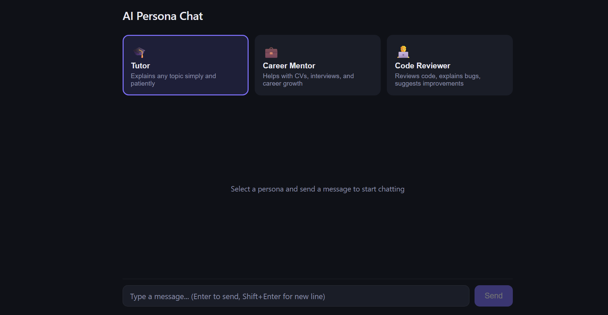

# AI Persona Chat


## 1. What it does

A chat app powered by the Claude API. Pick a persona (Tutor, Career Mentor, or Code Reviewer) and chat with Claude in that role. Each response is returned as one complete message.

## 2. Prerequisites

- Python 3.10 or newer (check with `python --version`)
- Node.js with npm (check with `node --version` and `npm --version`)
- An Anthropic API key

Create `backend/.env` from the template.

Windows (PowerShell or Command Prompt):

```bash
copy backend\.env.example backend\.env
```

macOS or Linux:

```bash
cp backend/.env.example backend/.env
```

Open `backend/.env` and set the `ANTHROPIC_API_KEY` line to your key. The file is git-ignored, so the key is never committed. If the key is missing, the server exits at startup with a clear error.

## 3. Installation

Backend, Windows:

```bash
cd backend
python -m venv venv
venv\Scripts\activate
pip install -r requirements.txt
```

Backend, macOS or Linux:

```bash
cd backend
python3 -m venv venv
source venv/bin/activate
pip install -r requirements.txt
```

Frontend, all systems:

```bash
cd frontend
npm install
```

## 4. Running

Start the backend (port 5000). On Windows, run `venv\Scripts\activate`. On macOS or Linux, run `source venv/bin/activate`.

```bash
cd backend
python app.py
```

Start the frontend (port 5173), in a second terminal:

```bash
cd frontend
npm run dev
```

Open `http://localhost:5173` in your browser.

## Prompt caching and token usage

Each request sends two system blocks: a short persona instruction, then the full persona document from `backend/personas/`. The document block is marked with `cache_control: ephemeral`, so Anthropic can cache it across requests.

Caching only activates when the cached prefix reaches the model's minimum length. The persona documents are sized to reach that minimum, but this is verified, not assumed.

Every request is logged to `backend/server.log` with four token counts:

- `input`: uncached input tokens
- `output`: generated tokens
- `cache_creation_input`: tokens written to the cache on this request
- `cache_read`: tokens read from the cache on this request

A healthy cache looks like this: the first request for a persona shows a non-zero `cache_creation_input`, and later requests for the same persona show a non-zero `cache_read` with a small `input`. If `cache_creation_input` and `cache_read` are both always `0`, the cached prefix is below the minimum length.
